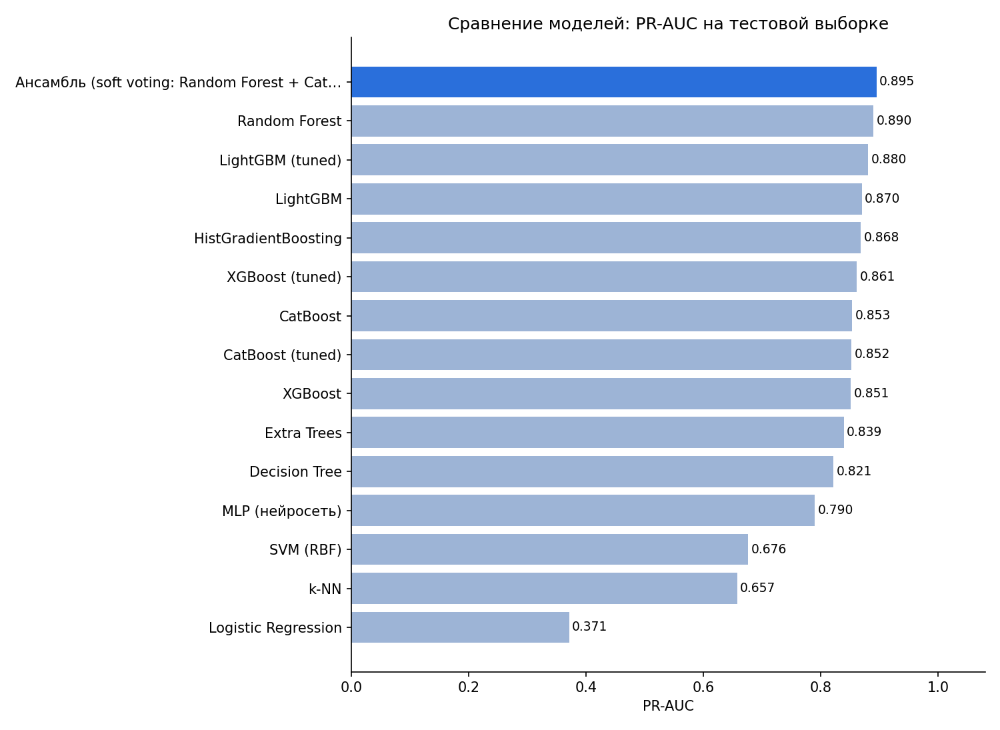
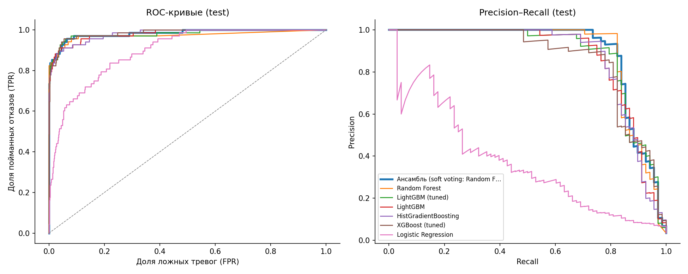
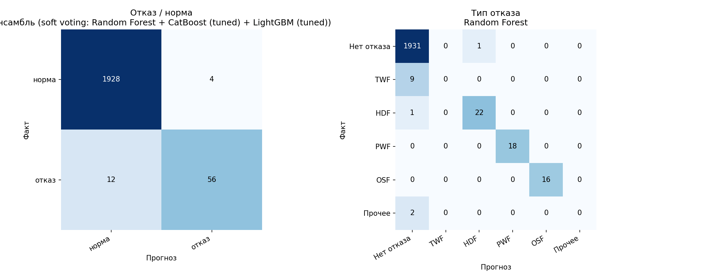
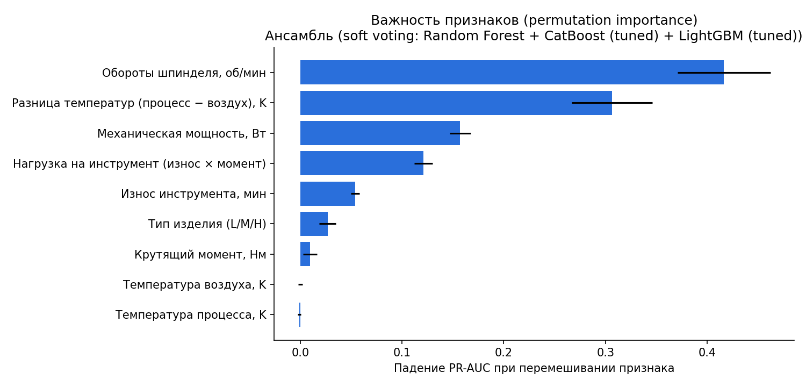

# Предиктивный ремонт и диагностика оборудования

Пилотная модель на открытых промышленных данных. Система по показаниям датчиков станка:
1. **прогнозирует отказ** оборудования до того, как он произойдёт;
2. **называет причину**: износ инструмента, перегрев, выход мощности за допуск или механическую перегрузку.



## Данные

**AI4I 2020 Predictive Maintenance Dataset**, UCI Machine Learning Repository (id 601), лицензия CC BY 4.0.
https://archive.ics.uci.edu/dataset/601/ai4i+2020+predictive+maintenance+dataset

- 10 000 записей фрезерного станка: температура воздуха и процесса (K), обороты шпинделя (об/мин), крутящий момент (Нм), наработка инструмента (мин), класс изделия L/M/H.
- 339 отказов (3.4%), дисбаланс классов 28 : 1.
- Режимы отказа: TWF (износ инструмента), HDF (перегрев), PWF (мощность вне допуска), OSF (перегрузка), RNF (случайный).

Файл датасета лежит в `data/raw/ai4i2020.csv`.

## Как сделано

**Признаки.** К 6 исходным параметрам добавлены 3 физических признака:

| Признак | Формула | Связанный отказ |
|---|---|---|
| Разница температур | T процесса − T воздуха | HDF, перегрев |
| Механическая мощность | момент × обороты × 2π / 60 | PWF, мощность вне допуска |
| Нагрузка на инструмент | износ × момент | OSF, перегрузка |

Эти признаки подняли CV PR-AUC деревьев и бустингов на 0.07–0.16 (лист «Feature engineering» в Excel).

**Модели.**
- Прогноз отказа (бинарная классификация), 15 моделей: Logistic Regression, k-NN, SVM, MLP, Decision Tree, Random Forest, Extra Trees, HistGradientBoosting, XGBoost, LightGBM, CatBoost. У XGBoost, LightGBM и CatBoost гиперпараметры подобраны случайным поиском (40 комбинаций). Финальная модель — soft-voting ансамбль трёх лучших.
- Диагностика типа отказа (мультикласс), 9 моделей.

**Валидация.**
- Стратифицированное разбиение 80 / 20. Тестовая часть не участвует ни в обучении, ни в подборе.
- 5-кратная стратифицированная кросс-валидация на обучающей части.
- Лучшая модель выбирается по CV, а не по тесту.
- Порог тревоги подбирается на out-of-fold прогнозах.
- Главная метрика — PR-AUC: при 3.4% отказов accuracy неинформативна, модель «всегда норма» даёт 96.6%.

## Результаты

### Прогноз отказа (тест: 2000 записей, 68 отказов)

| Модель | CV PR-AUC | Test PR-AUC | Test ROC-AUC | Recall | Precision | F1 |
|---|---|---|---|---|---|---|
| **Ансамбль (RF + CatBoost + LightGBM)** | **0.900 ± 0.014** | **0.895** | 0.983 | 82.4% | 93.3% | 0.875 |
| Random Forest | 0.892 ± 0.013 | 0.890 | 0.972 | 82.4% | 98.2% | 0.896 |
| LightGBM (tuned) | 0.890 ± 0.028 | 0.880 | 0.980 | 75.0% | 91.1% | 0.823 |
| HistGradientBoosting | 0.883 ± 0.017 | 0.868 | 0.980 | 76.5% | 89.7% | 0.825 |
| XGBoost (tuned) | 0.887 ± 0.028 | 0.861 | 0.984 | 73.5% | 89.3% | 0.806 |
| CatBoost (tuned) | 0.890 ± 0.013 | 0.852 | 0.985 | 77.9% | 91.4% | 0.841 |
| Extra Trees | 0.845 ± 0.016 | 0.839 | 0.975 | 72.1% | 86.0% | 0.784 |
| Decision Tree | 0.819 ± 0.031 | 0.821 | 0.921 | 72.1% | 96.1% | 0.824 |
| MLP | 0.817 ± 0.023 | 0.790 | 0.965 | 70.6% | 75.0% | 0.727 |
| SVM (RBF) | 0.661 ± 0.054 | 0.676 | 0.962 | 63.2% | 54.4% | 0.585 |
| k-NN | 0.656 ± 0.043 | 0.657 | 0.916 | 72.1% | 54.4% | 0.620 |
| Logistic Regression (база) | 0.469 ± 0.055 | 0.371 | 0.896 | 42.6% | 35.4% | 0.387 |

Полная таблица со всеми 15 моделями и метриками (F2, MCC, Balanced Accuracy, Brier, матрицы ошибок, время обучения и инференса) лежит в Excel.



### Диагностика типа отказа

Лучшая модель — Random Forest: CV macro-F1 0.637 ± 0.013, тест macro-F1 0.659. Без непредсказуемых случайных отказов macro-F1 0.791. Тип реального отказа назван верно в 82.4% случаев.

| Тип отказа | Recall | Случаев в тесте |
|---|---|---|
| HDF, перегрев | 95.7% | 23 |
| PWF, мощность вне допуска | 100% | 18 |
| OSF, перегрузка | 100% | 16 |
| TWF, износ инструмента | 0% | 9 |
| Прочее (случайный) | 0% | 2 |



### Экономический эффект (условный)

При пороге минимальных затрат 65 из 68 отказов предсказаны заранее, 3 пропущены, 134 ложные тревоги. Затраты на отказы снижаются на **75%**: 16.8 млн ₽ против 68 млн ₽ без системы.

Допущения: пропущенный отказ стоит 1 000 000 ₽, плановый ремонт 150 000 ₽, ложная тревога 30 000 ₽. Значения меняются в константах `COST_*` в начале `pdm_pipeline.py`.

### Важность признаков



## Структура репозитория

| Путь | Что внутри |
|---|---|
| `pdm_pipeline.py` | весь пайплайн: данные → признаки → модели → метрики → отчёт |
| `pdm_features.py` | единые формулы признаков и проверка входных данных, общие для обучения и инференса |
| `predict.py` | инференс: прогноз отказа и вероятной причины (CLI и Python API) |
| `tests/` | тесты инференса (pytest) |
| `models/manifest.json` | SHA-256 файлов моделей, версии библиотек, порог, список признаков |
| `results/metrics_models.xlsx` | **главный файл с метриками**: итоги, тест, CV, экономика, тип отказа, матрицы ошибок, важность признаков, вклад feature engineering, гиперпараметры, описание метрик, графики |
| `results/metrics_binary.csv`, `results/metrics_multiclass.csv` | сводные таблицы в CSV |
| `results/figures/` | графики |
| `results/demo_data.json` | данные для демо-страницы |
| `models/` | обученные лучшие модели (joblib) и порог тревоги |
| `demo/predictive_maintenance_demo.html` | интерактивная демонстрация: симулятор станка, мониторинг парка, экономика порога. Открывается двойным кликом, сервер не нужен |
| `demo/template.html`, `build_demo.py` | шаблон и сборка демо-страницы |
| `data/raw/ai4i2020.csv` | исходный датасет |

## Запуск

Python 3.9, версии библиотек зафиксированы точно.

```bash
pip install -r requirements.txt   # на macOS для xgboost/lightgbm: brew install libomp
python pdm_pipeline.py            # около 3 минут, результат воспроизводим (seed 42)
python build_demo.py
python -m pytest tests            # 11 тестов инференса
```

## Инференс

На вход подаются класс изделия и 5 показаний датчиков. Признаки модель считает сама.

```bash
# одна запись
python predict.py --json '{"type": "L", "air_temp_k": 300, "process_temp_k": 310, "rpm": 1320, "torque_nm": 58, "tool_wear_min": 205}'

# пакет из CSV (колонки AI4I или короткие: type, air_temp_k, process_temp_k, rpm, torque_nm, tool_wear_min)
python predict.py --input sensors.csv --output predictions.csv
```

```json
{"risk": 0.9007, "status": "тревога", "alarm": true,
 "likely_cause": "OSF", "likely_cause_ru": "механическая перегрузка", "likely_cause_p": 0.993, "notes": ""}
```

Из кода:

```python
from predict import Predictor

pred = Predictor.load("models")
result = pred.predict(df)   # df с показаниями -> risk, status, alarm, likely_cause, notes
```

| Поле | Значение |
|---|---|
| `risk` | вероятность отказа от 0 до 1 |
| `status` | `норма` / `наблюдение` (риск ≥ порог/3) / `тревога` (риск ≥ 0.512) / `ошибка данных` |
| `likely_cause` | вероятный тип отказа (TWF, HDF, PWF, OSF, Прочее), только при наблюдении или тревоге |
| `notes` | проблемы входных данных |

**Как устроена надёжность инференса:**
- **Одни формулы признаков.** И обучение, и прогноз вызывают `make_features()` из `pdm_features.py`, поэтому признаки не могут разойтись.
- **Проверка входа.** Пропуск, неизвестный класс изделия или физически невозможное значение дают статус `ошибка данных`, прогноз не делается. Значения вне диапазона обучения прогнозируются, но с предупреждением в `notes`.
- **Проверка файла модели.** Перед загрузкой сверяется SHA-256 из `models/manifest.json`. joblib (pickle) может выполнить код при загрузке, поэтому изменённый файл не открывается вообще. Загружайте модели только из доверенного источника.
- **Проверка версий.** Если версии scikit-learn, LightGBM, CatBoost, XGBoost, NumPy или joblib не совпадают с теми, в которых сохранена модель, загрузка прерывается.

## Ограничения

- AI4I 2020 синтетический датасет, построенный по реальному процессу. На данных предприятия метрики будут ниже.
- Износ инструмента (TWF) и случайные отказы (RNF) по текущим датчикам практически не предсказуемы.
- Стоимости в экономическом расчёте условные.
- Для внедрения нужны история показаний АСУ ТП и журналы ремонтов предприятия.

## Источник данных

Matzka, S. (2020). *AI4I 2020 Predictive Maintenance Dataset*. UCI Machine Learning Repository. https://archive.ics.uci.edu/dataset/601. Лицензия CC BY 4.0.
